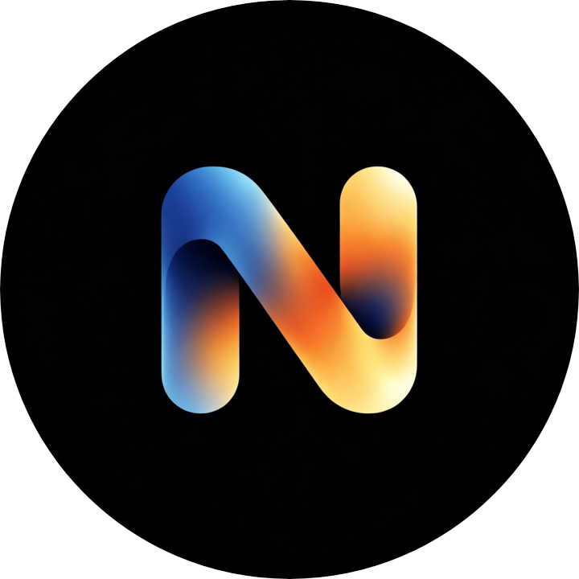

<div align="center">



# NeoWarp SOLO

**一个纯粹的 AI 编程工作区 —— 面向 Scratch (.sb3) 与 JavaScript 项目**

[](LICENSE)
[](https://www.electronjs.org/)


[简体中文](./README.md) · [English](./README_EN.md)

</div>

---

## 简介

**NeoWarp SOLO** 是一款基于 Electron 的桌面应用，把 AI 对话与 Scratch / JavaScript 项目编辑深度整合：你不再需要逐块拖拽积木，直接用自然语言告诉 AI「做什么」，由 AI 读取项目上下文、编写积木与代码、修改角色与素材，最终在可独立弹出的舞台窗口中运行结果。

它以 TurboWarp（scratch-gui）为底座构建，保留了完整的 Scratch 扩展生态与积木编辑体验，同时提供了扩展编辑器、打包器、手机协同编程等一整套配套工具。

## 功能特性

### 🎨 AI 驱动的编辑

- **AI 助手** —— 对话式编辑当前项目。AI 通过 `execute_operations` 工具直接操作项目：新建/插入/删除积木（内置一整套按操作码生成的积木词典与 DSL 协议）、增改角色、造型、声音与背景等。
- **SOLO 模式** —— 纯 AI 编程工作区。AI 可自主新建空白 .sb3 工程、按要求逐步构建完整作品；舞台以独立窗口弹出运行，编辑与运行互不干扰。
- **扩展编辑器** —— 在 Monaco 编辑器中用 AI 编写 TurboWarp 扩展（JavaScript），随时预览与加载调试。
- **多模型配置** —— 支持 OpenAI 兼容端点（DeepSeek、SiliconFlow、Groq 等自定义端点)、Anthropic、Ollama 等接入方式，可配置思考等级与上下文上限；配置在 AI 助手、SOLO、扩展编辑器与桌面设置之间实时同步，API Key 仅保存在本机。

### 🧩 项目工具箱

- **打包器** —— 集成 TurboWarp Packager，将项目打包为独立的 HTML / 压缩包等格式直接分发。
- **项目分析** —— 扫描工程结构与素材，生成分析报告。
- **图片编辑器、任务管理器、待办清单** 等配套小工具。
- **约 40 余窗口功能**：迁移助手、欢迎引导、桌面设置、关于 / 隐私 / 联系页面、最近项目、更新检查等。

### 🌐 协同与分享

- **手机编程（Phone Sync）** —— 扫码后手机端获得与桌面完全一致的 AI 对话界面（注入桥接脚本、SSE 实时事件流），可在手机上查看状态并发起操作；桌面是唯一事实源，所有路由均有随机 token 鉴权，防止局域网陌生设备控制。
- **本地协作房间** —— 基于 WebSocket 的本地协作服务器，支持房间发现（扫描本机 /24 子网）、密码鉴权、心跳保活。
- **独立舞台窗口（Detached Stage）** —— 把舞台弹出为独立窗口，方便直播、演示和运行大项目。

### ⚙️ 桌面集成

- 文件关联：`.sb3` / `.sb2` / `.sb` / JavaScript 扩展文件直接双击打开。
- TurboWarp 附加组件（Addons）完整支持。
- **Expands 本地扩展目录**（`nw-expands://` 协议）：打包版可直接在可执行文件同级放置 `Expands/` 目录加载本地扩展。
- 富状态、菜单栏与右键菜单、媒体权限、崩溃提示等完整的桌面用户体验。

## 下载安装

前往 [Releases](https://github.com/Shiyuan-318/NeoWarp-SOLO/releases) 页面下载对应平台的安装包：

| 平台 | 格式 |
| --- | --- |
| Windows | NSIS 安装包 / 免安装便携版（x64） |
| macOS | 通用（Universal）DMG |
| Linux | `deb` / `tar.gz` / `AppImage` |

## 快速上手

1. 启动 NeoWarp SOLO，完成欢迎引导；
2. 在「桌面设置」或 AI 助手中添加你的 AI 模型配置（端点 + API Key）；
3. 打开一个 `.sb3` 项目，或直接使用 SOLO 模式描述需求让 AI 从零构建；
4. 用自然语言与 AI 对话，逐步完善项目，随时在舞台运行查看效果；
5. 满意后用打包器导出分享。

## 从源码构建

### 环境要求

- **Node.js** ≥ 22（CI 使用 24）、npm
- Windows / macOS / Linux 任一开发环境；打包对应平台产物建议使用对应平台

### 步骤

```bash
# 1. 安装依赖（postinstall 会自动执行 patch-package）
npm install

# 2. 拉取运行时资源（素材库文件、打包器、扩展分发文件）
npm run fetch

# 3. 编译渲染端（开发时可用 npm run webpack:watch 增量编译）
npm run webpack:compile

# 4. 启动应用
npm run electron:start
```

### 打安装包

```bash
npm run electron:build                          # 按当前平台打包
# 或使用发布自动化脚本，例如：
node release-automation/build.mjs --windows --x64
node release-automation/build.mjs --mac --universal
node release-automation/build.mjs --debian --tarball --appimage --x64
```

### AI 协议维护脚本

AI 积木词典与系统提示词由脚本生成，避免与执行器漂移：

```bash
npm run ai:schema   # 生成操作码架构（OPCODE_SCHEMA）
npm run ai:prompt   # 重新组装系统提示词并写入 ai-assistant.html
npm run ai:check    # 校验 schema / 提示词是否最新
npm run ai:test     # 运行 DSL 往返、数据工具、流式重试等测试
```

## 项目结构

```
├─ src-main/                  # Electron 主进程（窗口、协议、服务）
│  └─ windows/                # 各功能窗口（AI 助手、SOLO、扩展编辑器、打包器等）
├─ src-preload/               # 各窗口 preload 桥接
├─ src-renderer/              # 各功能窗口页面（HTML / JS / CSS）
├─ src-renderer-webpack/      # 经 webpack/babel 编译的编辑器渲染端源码
├─ dist-library-files/        # 生成产物：素材库（npm run fetch）
├─ dist-extensions/           # 生成产物：预压缩扩展（npm run fetch）
├─ dist-renderer-webpack/     # 生成产物：编辑器编译输出（webpack）
├─ scripts/                   # 构建、AI 协议与测试工具脚本
├─ release-automation/        # 发布打包自动化脚本
├─ .github/workflows/         # CI：手动构建 + vX.Y.Z 标签自动发布 Releases
├─ build/                     # 打包图标、NSIS 安装器、Mac 权限文件
├─ linux-files/               # Linux desktop / metainfo / mime
├─ art/                       # 应用图标源文件
├─ font/                      # HarmonyOS Sans SC 字体
├─ Expands/                   # 本地扩展目录（nw-expands://）
└─ patches/                   # patch-package 补丁
```

> `dist-*` 与 `node_modules/` 为生成产物，不纳入版本管理，构建时重新生成。

## 持续集成与发布

- **`.github/workflows/build.yml`** —— 手动触发，分别在 Ubuntu / macOS / Windows 上完成完整构建并上传 Artifacts。
- **`.github/workflows/release.yml`** —— 推送 `v*` 标签自动触发，三平台构建后上传至 GitHub Releases。

## 安全与隐私

- 你的 AI API Key 与全部配置仅保存在本机 `tw_config.json` 与应用数据目录中，不会上传。
- 手机编程与本协作房间均使用随机 token / 密码鉴权，且只监听局域网。
- 仓库不包含任何 API Key（"免费模型中转"功能的密钥在开源前已被移除，配置为空字符串时不启用该功能）。

## 致谢

本项目基于并大量使用以下出色的开源项目：

- [TurboWarp](https://github.com/TurboWarp)（Desktop 架构、scratch-gui、extensions、packager、scaffolding）
- [Electron](https://github.com/electron/electron)、[electron-builder](https://github.com/electron-userland/electron-builder)、[Monaco Editor](https://github.com/microsoft/monaco-editor)
- [HarmonyOS Sans SC](https://developer.huawei.com/consumer/cn/design/font/) 字体

感谢 Scratch 与 TurboWarp 社区。

## 贡献

Issue 与 Pull Request 均受欢迎。提交修改前请运行 `npm run ai:check` 与测试脚本确认 AI 协议同步；涉及多端同步的功能请同时更新 `src-main` / `src-preload` / `src-renderer` 三处实现。

## 许可证

本项目基于 **GPL-3.0** 许可证发布，详见 [LICENSE](LICENSE)。
基于 TurboWarp 与 scratch-gui（GPL 许可）构建的项目将继续采用 GPL 许可分发。
