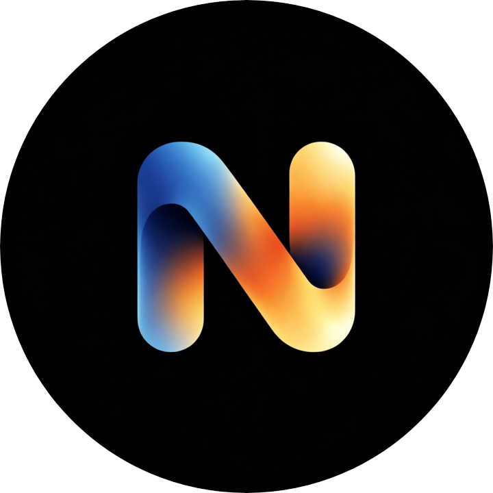

<div align="center">



# NeoWarp SOLO

**A pure AI programming workspace — for Scratch (.sb3) and JavaScript projects**

[](LICENSE)
[](https://www.electronjs.org/)


[简体中文](./README.md) · [English](./README_EN.md)

</div>

---

## Introduction

**NeoWarp SOLO** is an Electron-based desktop app that deeply integrates AI conversation with Scratch / JavaScript project editing: instead of dragging blocks by hand, you tell the AI *what* to do in natural language. The AI reads the project context, writes blocks and code, modifies sprites and assets, and the result runs in a detachable stage window.

It is built on top of TurboWarp (scratch-gui), preserving the full Scratch extension ecosystem and block-editor experience, while bundling a complete toolkit: an extension editor, a packager, phone-synced AI programming, and more.

## Features

### 🎨 AI-powered editing

- **AI Assistant** — Conversational editing of the current project. The AI operates on the project through the `execute_operations` tool: creating / inserting / deleting blocks (with a generated block dictionary and DSL protocol), and managing sprites, costumes, sounds and backdrops.
- **SOLO mode** — A pure AI programming workspace. The AI can create a blank .sb3 project on its own and build a complete program step by step from your description; the stage pops out into its own window so editing and running never get in each other's way.
- **Extension Editor** — Write TurboWarp extensions (JavaScript) with AI in a Monaco editor, with live preview and load-to-debug support.
- **Multi-model config** — Connect via OpenAI-compatible endpoints (custom endpoints such as DeepSeek, SiliconFlow, Groq…), Anthropic, or Ollama, with configurable thinking level and context limit. Configs sync in real time across the AI Assistant, SOLO, the Extension Editor and Desktop Settings; API keys are stored locally only.

### 🧩 Project toolbox

- **Packager** — Integrated TurboWarp Packager to bundle projects into standalone HTML / zip files for direct distribution.
- **Project Analysis** — Scans project structure and assets, generating an analysis report.
- **Image editor, task manager, todo list** — companion utilities.
- **40+ window features**: migration assistant, onboarding, desktop settings, about / privacy / contact pages, recent projects, update checker, and more.

### 🌐 Collaboration & sharing

- **Phone Sync** — After scanning a QR code, the phone gets the exact same AI-conversation UI as the desktop (with an injected bridge script and an SSE event stream), so you can view the state and issue commands from the phone. The desktop is the single source of truth; every route requires a random token so strangers on the LAN cannot take control.
- **Local collaboration rooms** — A WebSocket-based local collaboration server with room discovery (scanning the machine's /24 subnets), password authentication and heartbeat keep-alive.
- **Detached Stage** — Pop the stage out into its own window for streaming, presentations, or running big projects.

### ⚙️ Desktop integration

- File associations: double-click `.sb3` / `.sb2` / `.sb` / JavaScript extension files to open them.
- Full support for TurboWarp Addons.
- **Expands local extension folder** (`nw-expands://` protocol): portable builds can load local extensions by dropping an `Expands/` folder next to the executable.
- Rich presence, menu bar & context menus, media permissions, crash dialogs, and a polished desktop experience.

## Download

Grab the installer for your platform from the [Releases](https://github.com/Shiyuan-318/NeoWarp-SOLO/releases) page:

| Platform | Format |
| --- | --- |
| Windows | NSIS installer / portable executable (x64) |
| macOS | Universal DMG |
| Linux | `deb` / `tar.gz` / `AppImage` |

## Getting started

1. Launch NeoWarp SOLO and complete the onboarding;
2. Add your AI model configuration (endpoint + API key) in Desktop Settings or the AI Assistant;
3. Open an `.sb3` project, or use SOLO mode and describe what you want so the AI builds it from scratch;
4. Chat with the AI in natural language, refine the project step by step, and run it on the stage anytime;
5. When you are happy, export and share with the Packager.

## Building from source

### Prerequisites

- **Node.js** ≥ 22 (CI uses 24) and npm
- Any development platform: Windows / macOS / Linux; build platform-specific artifacts on the matching OS when possible

### Steps

```bash
# 1. Install dependencies (postinstall runs patch-package automatically)
npm install

# 2. Fetch runtime assets (library files, packager, extension distributions)
npm run fetch

# 3. Compile the renderer (use npm run webpack:watch for incremental builds)
npm run webpack:compile

# 4. Run the app
npm run electron:start
```

### Packaging

```bash
npm run electron:build                          # package for the current platform
# Or use the release automation script, e.g.:
node release-automation/build.mjs --windows --x64
node release-automation/build.mjs --mac --universal
node release-automation/build.mjs --debian --tarball --appimage --x64
```

### AI protocol maintenance scripts

The AI block dictionary and system prompt are generated by scripts to avoid drift from the executor:

```bash
npm run ai:schema   # generate the opcode schema (OPCODE_SCHEMA)
npm run ai:prompt   # re-assemble and write the system prompt into ai-assistant.html
npm run ai:check    # verify the schema / prompt are up to date
npm run ai:test     # run DSL round-trip, data tools, stream retry and other tests
```

## Project structure

```
├─ src-main/                  # Electron main process (windows, protocols, services)
│  └─ windows/                # Feature windows (AI assistant, SOLO, extension editor, packager…)
├─ src-preload/               # Preload bridges for each window
├─ src-renderer/              # Window pages (HTML / JS / CSS)
├─ src-renderer-webpack/      # Editor renderer sources compiled via webpack/babel
├─ dist-library-files/        # Generated: library files (npm run fetch)
├─ dist-extensions/           # Generated: pre-compressed extensions (npm run fetch)
├─ dist-renderer-webpack/     # Generated: compiled editor output (webpack)
├─ scripts/                   # Build, AI protocol, and test tooling
├─ release-automation/        # Release packaging automation
├─ .github/workflows/         # CI: manual builds + vX.Y.Z tag → auto release
├─ build/                     # Packaging icons, NSIS installer, Mac entitlements
├─ linux-files/               # Linux desktop / metainfo / mime
├─ art/                       # App icon sources
├─ font/                      # HarmonyOS Sans SC fonts
├─ Expands/                   # Local extension folder (nw-expands://)
└─ patches/                   # patch-package patches
```

> `dist-*` and `node_modules/` are generated artifacts, excluded from version control and regenerated at build time.

## CI & releases

- **`.github/workflows/build.yml`** — Manually triggered; full builds on Ubuntu / macOS / Windows with artifacts uploaded.
- **`.github/workflows/release.yml`** — Triggered automatically by pushing a `v*` tag; builds on three platforms and uploads to GitHub Releases.

## Security & privacy

- Your AI API keys and all settings stay local (`tw_config.json` and the app data directory); nothing is uploaded.
- Phone Sync and collaboration rooms authenticate with random tokens / passwords and bind to the LAN only.
- The repository contains no API keys (the "free model relay" key was removed before open-sourcing; an empty key string disables the feature).

## Acknowledgements

This project is built upon, and makes heavy use of, these excellent open-source projects:

- [TurboWarp](https://github.com/TurboWarp) (Desktop architecture, scratch-gui, extensions, packager, scaffolding)
- [Electron](https://github.com/electron/electron), [electron-builder](https://github.com/electron-userland/electron-builder), [Monaco Editor](https://github.com/microsoft/monaco-editor)
- [HarmonyOS Sans SC](https://developer.huawei.com/consumer/cn/design/font/) typeface

Thanks to the Scratch and TurboWarp communities.

## Contributing

Issues and pull requests are welcome. Before submitting changes, run `npm run ai:check` and the test scripts to confirm the AI protocol is in sync; features that span processes should keep `src-main` / `src-preload` / `src-renderer` implementations consistent.

## License

This project is released under the **GPL-3.0** license. See [LICENSE](LICENSE).
Derived from TurboWarp and scratch-gui (GPL-licensed), this project is likewise distributed under the GPL.
